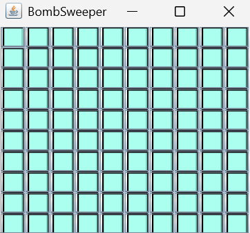
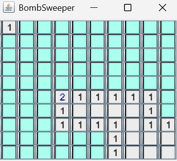
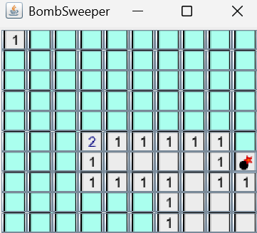

# BombSweeper

BombSweeper is a small Minesweeper-style desktop game written in Java with Swing. Explore a grid of hidden squares, use number clues to locate nearby bombs, and reveal connected empty areas with a single click.

The project demonstrates object-oriented design, inheritance, event handling, two-dimensional arrays, neighbor detection, and recursive area expansion. It runs locally using the standard Java libraries, with no external dependencies or build tools.



## Table of Contents

- [Features](#features)
- [Requirements](#requirements)
- [Install Java](#install-java)
  - [Windows](#windows)
  - [macOS](#macos)
  - [Linux](#linux)
  - [Verify the installation](#verify-the-installation)
- [Download The Project](#download-the-project)
- [Compile and Run](#compile-and-run)
- [Run From An IDE](#run-from-an-ide)
- [How To Play](#how-to-play)
- [Project Structure](#project-structure)
- [How The Code Works](#how-the-code-works)
- [API Documentation](#api-documentation)
- [Troubleshooting](#troubleshooting)

## Features

- A clickable 10 x 10 board containing 100 squares.
- Random bomb placement with an independent 10% chance per square.
- Number clues showing bombs in the eight surrounding positions, including diagonals.
- Recursive expansion of empty regions and their bordering number clues.
- Image-based hidden squares, revealed squares, numbers, and bombs.
- Bounds checks for squares along the edges and corners.
- A compact design built around four Java classes.

The total number of bombs varies between boards. A 10% chance per square means about 10 bombs on average, rather than exactly 10 every game.

## Requirements

| Requirement | Purpose |
| --- | --- |
| A Java Development Kit (JDK) | Provides `javac` to compile the source and `java` to run it. JDK 21 is a suggested setup. |
| Windows, macOS, or Linux with a graphical desktop | Displays the Swing game window. |
| The complete project folder, including `images/` | Supplies the source files and runtime tile images. |
| Git, optional | Downloads the repository using the command line. A ZIP download also works. |

Swing and AWT are included in a standard desktop JDK. Maven, Gradle, JavaFX, a database, and additional Java libraries are not required. An IDE is optional. After downloading the project and installing Java, the game works offline.

## Install Java

If both `java` and `javac` are already installed, go to [Verify the installation](#verify-the-installation).

Choose a **JDK**, rather than a JRE-only download: a JRE alone does not provide the compiler. The steps below use [Eclipse Temurin downloads](https://adoptium.net/temurin/releases/). Select JDK 21 and the architecture appropriate for your computer, usually x64 for Intel/AMD machines or aarch64 for ARM machines.

### Windows

1. Open the [Temurin download page](https://adoptium.net/temurin/releases/).
2. Select Windows, your processor architecture, version 21, and package type JDK.
3. Download the `.msi` installer if available for your architecture.
4. Open the installer and follow its prompts. Keep the option to add Java to `PATH` enabled. You can also enable the `JAVA_HOME` option.
5. Finish installing, then close and reopen PowerShell or Command Prompt.
6. Run the commands in [Verify the installation](#verify-the-installation).

See the [official Windows installation guide](https://adoptium.net/installation/windows/) for installer details. If an MSI is unavailable for your architecture, use the [archive installation guide](https://adoptium.net/installation/archives/) for the matching JDK archive.

### macOS

1. Open the [Temurin download page](https://adoptium.net/temurin/releases/).
2. Select macOS, version 21, and package type JDK. Choose aarch64 for Apple Silicon or x64 for an Intel Mac.
3. Download the `.pkg` installer.
4. Open the downloaded package and follow the installation prompts.
5. Open a new Terminal window and run the commands in [Verify the installation](#verify-the-installation).

See the [official macOS installation guide](https://adoptium.net/installation/macOS/) for details.

### Linux

Use a full JDK package on a system with a graphical desktop. For Ubuntu or Debian systems whose repositories provide OpenJDK 21:

1. Open a terminal.
2. Refresh the package list:

   ```sh
   sudo apt update
   ```

3. Install the JDK:

   ```sh
   sudo apt install openjdk-21-jdk
   ```

4. Run the commands in [Verify the installation](#verify-the-installation).

For other distributions, or if that package is unavailable, follow the [Temurin Linux package instructions](https://adoptium.net/installation/linux/). Choose a full desktop-capable JDK; a headless-only environment cannot display the game.

### Verify The Installation

Run these commands in PowerShell, Command Prompt, or a terminal:

```text
java -version
javac -version
```

Both should print a version number. With the suggested setup, both report version 21. Other JDK versions may work, but use a matching compiler and runtime. If either command is missing, see [Troubleshooting](#troubleshooting).

## Download The Project

Choose either method. Keep the source files and folders together.

### Option 1: Download a ZIP without Git

1. Open the [BombSweeper repository](https://github.com/sahasatyaki/Bomb-Sweeper).
2. Click **Code**, then **Download ZIP**.
3. Extract the ZIP into a folder you can easily find. On Windows, right-click the ZIP and select **Extract All**.
4. Open the extracted folder containing `Driver.java`, `BombSquare.java`, `GameBoard.java`, `GameSquare.java`, and `images/`. Depending on the branch name, the folder may be called `Bomb-Sweeper-main`.
5. Open a terminal in that folder, or use `cd` with its full path. For example, replacing the example path with your actual location:

   ```text
   cd "path/to/Bomb-Sweeper-main"
   ```

Extract the archive before running the game; do not attempt to launch it from inside the ZIP.

### Option 2: Clone with Git

1. If needed, install Git using the [official Git installation page](https://git-scm.com/install/) for your operating system, then reopen your terminal.
2. Confirm installation:

   ```text
   git --version
   ```

3. Download the repository and enter its folder:

   ```text
   git clone https://github.com/sahasatyaki/Bomb-Sweeper.git
   cd Bomb-Sweeper
   ```

## Compile and Run

Run every command below from the **project root**, the folder containing `Driver.java` and `images/`. These commands work in PowerShell, Command Prompt, and standard macOS/Linux shells.

1. Create a directory for compiled classes. Do this once; if `out` already exists, skip this command:

   ```text
   mkdir out
   ```

2. Compile all four source files:

   ```text
   javac -d out Driver.java GameBoard.java GameSquare.java BombSquare.java
   ```

   Successful compilation normally produces no terminal output. The compiled `.class` files appear in `out/`.

3. Start the game:

   ```text
   java -cp out Driver
   ```

4. A window titled `BombSweeper` opens with a new hidden board. Left-click squares to play.
5. Close the game window to exit. To start another board, run `java -cp out Driver` again from the project root.

You do not need to recompile between games unless the source changes. The `images/` folder must remain in the project root: the program loads paths such as `images/blank.png` relative to the working directory. Keep your terminal in the project root even though the compiled classes are inside `out/`.

## Run From An IDE

The command-line instructions above are sufficient; no IDE download is required. If you already use a Java IDE:

1. Open the project root as a Java project or folder.
2. Select your installed JDK as the project's Java SDK.
3. Ensure the four `.java` files are included as Java sources. They use the default package.
4. Create or select a Java application run configuration with main class `Driver`.
5. Set the working directory to the project root containing `images/`.
6. Run the configuration.

No external dependencies need to be added. If the game opens with missing tile images, check the run configuration's working directory.

## How To Play

The goal is to reveal safe squares while avoiding bombs. This implementation lets you explore the board without automatically ending the session after a bomb click.

1. **Start a board.** Every square begins hidden. The first click is not guaranteed to be safe.
2. **Left-click a square.** A safe square reveals either a number or an empty tile.
3. **Read the clues.** A number from 1 to 8 counts bombs immediately above, below, beside, or diagonally adjacent to that square. For example, a `1` means exactly one of its valid neighboring squares contains a bomb. Edge and corner squares have fewer neighbors.
4. **Use empty regions.** A square with no adjacent bombs appears empty. The game automatically opens its neighbors, continues through connected empty squares, and reveals the number clues around that region.
5. **Avoid suspected bombs.** Compare nearby clues to decide which hidden squares are safe. Some positions may require guessing.
6. **Recognize a bomb.** Clicking a bomb reveals its icon. You can continue clicking other squares; there is no game-over dialog or board lock.
7. **Start again.** Close the window and rerun the game for a newly randomized board.

### Revealing Safe Squares

The numbered tiles mark the boundary of an expanded empty area. The remaining colored tiles are still hidden.



### Revealing A Bomb

A clicked bomb displays its icon while other hidden squares remain available.



## How The Code Works

| File | Responsibility |
| --- | --- |
| `Driver.java` | Supplies `main` and creates `new GameBoard("BombSweeper", 10, 10)`. |
| `GameBoard.java` | Extends `JFrame`, creates the grid and its `BombSquare` objects, stores them in a `GameSquare[][]` array, and forwards button events to `clicked()`. Its `getSquareAt(x, y)` method returns `null` outside the board. |
| `GameSquare.java` | An abstract `JButton` subclass that stores square coordinates and the board reference, loads image icons, and declares the abstract `clicked()` method. Made in collaboration with Dr. Joe Finney. |
| `BombSquare.java` | Extends `GameSquare` with random bomb placement, an `opened` state, adjacent-bomb counting, and recursive empty-region expansion. Made in collaboration with Dr. Joe Finney. |

### Board Initialisation

`Driver` creates the board. `GameBoard` constructs one `BombSquare` for each position and arranges the buttons using `GridLayout`. Each square starts with `images/blank.png` and independently decides whether it contains a bomb using `Random.nextInt(MINE_PROBABILITY) == 0`. With `MINE_PROBABILITY` set to 10, that gives a one-in-ten chance.

### Click Handling and Recursion

1. A button click reaches `GameBoard.actionPerformed()`, which calls that square's `clicked()` method.
2. A bomb square is marked opened and displays `images/bomb.png`.
3. An already opened safe square returns without further expansion.
4. A newly opened safe square uses `count_bombs(x, y)` to inspect the eight neighboring positions, skipping coordinates outside the board.
5. If the count is positive, the corresponding number image is displayed.
6. If the count is zero, `empty_expansion()` displays `images/0.png` and calls `clicked()` on unopened neighboring squares.

The `opened` state prevents repeated recursive visits. Expansion continues through zero-count squares and stops at numbered boundary squares. Since a zero-count square has no adjacent bombs, its expansion reveals safe neighbors.

The following diagram illustrates the class relationships and click flow. The source files are the reference for exact member declarations and visibility.


## API Documentation

Generated Javadoc is included in `docs/`. Open `docs/index.html` from your downloaded copy in a web browser to browse the classes and documented methods. On GitHub, the [documentation entry file](docs/index.html) may display as HTML source; opening the local file renders the documentation.

To generate a fresh copy without replacing the included documentation, run this optional command from the project root:

```text
javadoc -d out/api-docs Driver.java GameBoard.java GameSquare.java BombSquare.java
```

Then open `out/api-docs/index.html` in your browser. Javadoc may report warnings for members that have no documentation comments.

## Troubleshooting

| Symptom | What to check |
| --- | --- |
| `java` or `javac` is not recognized, or the shell reports `command not found` | Install a full JDK, reopen the terminal, and ensure the JDK's `bin` directory is on `PATH`. A working `java` command alone does not confirm that the compiler is installed. |
| `error: file not found: Driver.java` | Change to the extracted project root before compiling. Confirm that you extracted the ZIP and are in the folder containing all four source files. |
| `Could not find or load main class Driver` | Compile successfully first, then run `java -cp out Driver` from the project root. Use `Driver` without `.java` or `.class`. |
| `UnsupportedClassVersionError` | The runtime is older than the compiler used for the `.class` files. Use a matching JDK for both commands, then compile again. |
| Tiles have no images or appear as empty buttons | Run from the project root and check that `images/blank.png`, `images/bomb.png`, and `images/0.png` through `images/8.png` are present. Filenames are case-sensitive on some systems. The screenshots in `assets/` do not replace these files. |
| `HeadlessException` or an error about a missing display | Run on a graphical desktop with display access. A terminal-only server, headless Java installation, or unconfigured remote shell cannot show the Swing window. |
| The board is small or differs from the screenshots | Window decorations, scaling, and button appearance depend on the operating system and Java look and feel. Resize the window if needed. |
| A bomb click does not stop play, or clearing safe squares shows no message | These are the current game behaviors; see [Current limitations](#current-limitations). |
| You want a new board | Close the window and run `java -cp out Driver` again. Each launch generates a new random layout. |